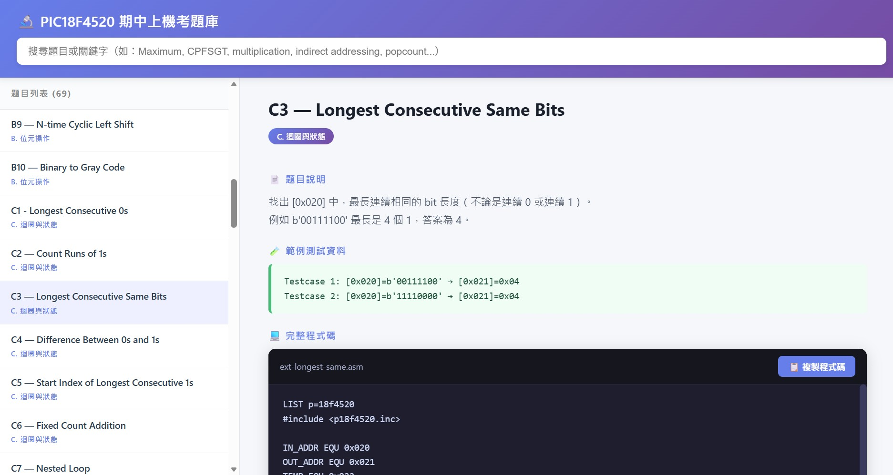
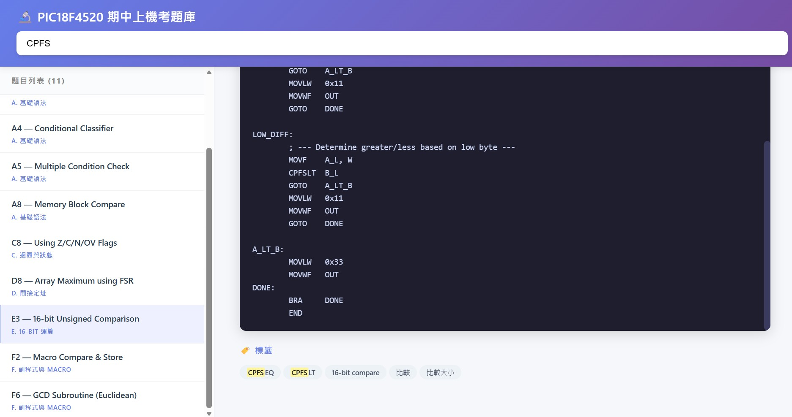

# PIC18F4520 期中上機題庫 (Midterm Cheat Sheet)

這是一個專為 **PIC18F4520 微算機期中上機考** 所建立的本地端（Local）題庫查詢系統。

因為考試期間無法連網，考前需要一份能快速搜尋、複習的「大抄」。本專案收錄了 69 道常見的組合語言（Assembly）考題，包含分類、題目描述、測試資料，以及附有簡潔英文註解的完整程式碼。

## 📸 網站截圖 (Screenshot)





## ✨ 功能特點 (Features)

- **完全離線使用**：純 HTML/CSS/JS 撰寫，不需要啟動伺服器，直接用瀏覽器打開即可。
- **關鍵字搜尋**：可搜尋題目、關鍵字（如：最大、CPFSGT、乘法、間接定址、popcount 等）。
- **分類瀏覽**：左側選單依難度與類型分為 A ~ G 七大類（基礎語法、位元操作、迴圈狀態、間接定址、16-bit 運算、副程式與 Macro、高階綜合）。
- **精簡英文註解**：程式碼皆附有段落式的英文註解，方便快速理解邏輯，不需要逐行死背。
- **快速複製**：每道題目的程式碼區塊都有「複製程式碼」按鈕，方便貼到 MPLAB 中測試。

## 📂 檔案架構 (File Structure)

```text
PIC18F4520 期中上機題庫/
│
│  ALL_PROBLEMS_TABLE.txt   # 所有題目的總表
│  app.js                   # 主要邏輯、搜尋與渲染
│  index.html               # 網頁主體
│  style.css                # 網頁樣式
│  
└─problems                  # 題庫資料夾
        problems_A.js       # A. 基礎語法
        problems_B.js       # B. 位元操作
        problems_C.js       # C. 迴圈與狀態
        problems_D.js       # D. 間接定址
        problems_E.js       # E. 16-bit 運算
        problems_F.js       # F. 副程式與 Macro
        problems_G.js       # G. 高階綜合